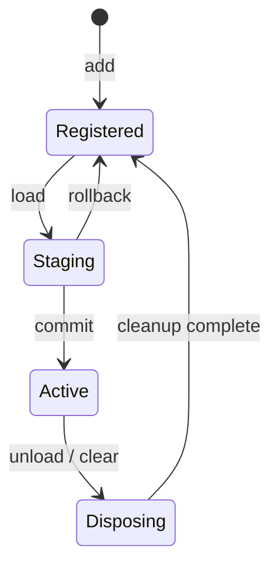

# C++ 插件系统

插件通过宿主管理的服务和类型事件扩展界面。加载建立一个作用域，卸载撤销该作用域的注册和资源。当前实现面向随应用编译的可信 C++ 插件，运行于所属宿主线程。当前 Compose 管理器在 NativeManager 串行工作线程拥有运行时；保留的 ImGui 示例使用渲染线程。

核心代码位于 [`plugin/runtime.h`](../app/src/main/cpp/plugin/runtime.h)；内置插件位于 [`features/builtin_plugins.cpp`](../app/src/main/cpp/features/builtin_plugins.cpp)，宿主接入位于 [`main.cpp`](../app/src/main/cpp/main.cpp)。

## 设计来源

参考用户指定的 [DeepSeek Harness](https://github.com/deepseek-ai/deepseek-harness) 及其内置 Cordis：

- [架构与 primer](https://github.com/deepseek-ai/deepseek-harness/blob/master/docs/cordis-primer.md)：插件通过上下文获取服务，通过类型事件协作，注册操作归属插件作用域。
- [生命周期与 effects](https://github.com/deepseek-ai/deepseek-harness/blob/master/docs/cordis-tutorial/02-lifecycle-and-effects.md)：资源具有明确的释放操作，卸载等待清理结束。
- [服务依赖](https://github.com/deepseek-ai/deepseek-harness/blob/master/docs/cordis-tutorial/03-services.md)：消费者声明依赖，避免依赖隐含在手写初始化顺序中。
- [vendored 修复记录](https://github.com/deepseek-ai/deepseek-harness/blob/master/vendor/README.md)：先登记清理再执行初始化，禁止在卸载过程中新增 effect，处理初始化失败和生命周期重入。

这里将上述思想落实为 C++17 的同步事务和作用域所有权。它不是 Cordis API 的直接移植：本实现拒绝卸载仍有消费者的提供者；不自动挂起和重启消费者；没有异步 disposer。DeepSeek 的加载配置变更也并非全部具有事务性，本实现的事务保证限于下面定义的注册和加载范围。

## 核心接口

类型位于 `vulkanscope::plugin` 命名空间。

| 接口 | 作用 |
| --- | --- |
| `PluginSpec{id, dependencies, setup}` | 定义插件 ID、所需插件 ID 和初始化函数 |
| `Runtime::add(spec)` | 登记定义，不执行初始化 |
| `Runtime::load(id)` | 加载插件及依赖，成功后发布注册并保留显式加载的插件 |
| `Runtime::unload(id)` | 卸载没有活跃消费者的插件，回收不再需要的自动依赖 |
| `Runtime::clear()` | 按逆依赖顺序卸载所有已加载插件 |
| `Runtime::emit<Event>(event)` | 同步分发某个类型的事件 |
| `Context::on<Event>(callback)` | 登记插件拥有的事件监听 |
| `Context::provide<T>(shared_ptr<T>)` | 发布按类型识别的服务 |
| `Context::service<T>()` | 获取受生命周期检查的 `ServiceHandle<T>` |
| `Context::defer(noexcept_cleanup)` | 登记插件卸载或加载回滚时运行的清理 |
| `Context::effect(acquire, noexcept_cleanup)` | 先登记清理，再执行资源获取 |
| `ServiceHandle<T>::borrow(callback)` | 在同步、返回 `void` 的回调内短暂访问服务 |

服务只允许一个活跃提供者。消费者只能访问自身或已声明依赖链中的服务；不通过全局单例旁路依赖关系。`Context` 不可复制，注册接口只允许在所属插件本次 `setup` 执行期间使用；运行中的回调通过初始化时取得的服务句柄协作。

## 加载与卸载

一次 `load` 会收集所需的新依赖，执行初始化并暂存事件和服务注册。全部成功后统一发布。若出现缺失依赖、依赖环、服务冲突或初始化异常，撤销本次事务新增的注册、插件和清理操作；调用前已加载的依赖继续存在。错误交还调用者处理。

下面是对外生命周期的示意，不对应额外的公开状态枚举：



卸载撤销监听和服务，清理操作按登记的逆序执行，最后释放插件持有的状态。清理函数必须是 `noexcept`，也不得抛异常、重新注册资源或调用加载/卸载操作。插件清空后定义仍可用于再次加载；每次初始化应创建自己的新状态。

`unload` 遇到活跃消费者时拒绝操作。例如 `device-info` 依赖 `host.reports`，应先卸载 `device-info`，然后才能卸载 `host.reports`。`clear` 负责按逆依赖顺序清空整张已加载依赖图。

通过 `load(id)` 显式加载的插件会保留，直到显式卸载或清空；为满足依赖而自动加载的插件，在最后一个消费者卸载后自动回收。对已经自动加载的依赖直接调用 `load`，会将它转为显式保留。加载失败不会改变之前的保留关系。因此一次“加载功能，再卸载功能”不会留下这次自动引入、又无人使用的依赖，也不会卸载之前明确保留的基础服务。

这是生命周期操作的事务，不是任意进程状态的快照。初始化函数中不能通过广播事件、改写全局变量或调用消费者来提前发布尚未提交的行为。

## 宿主与内置插件

[`features/builtin_plugins.h`](../app/src/main/cpp/features/builtin_plugins.h) 声明 `vulkanscope::RenderFrame`、`vulkanscope::HostReports` 和 `RegisterBuiltinPlugins(plugin::Runtime&, std::shared_ptr<HostReports>)`。登记函数只登记定义；宿主决定何时加载。

| 插件 | 职责 | 依赖 |
| --- | --- | --- |
| `host.reports` | 提供只读 `HostReports` 服务 | 无 |
| `frame-metrics` | 帧率、帧耗时和历史曲线 | 无 |
| `device-info` | 系统报告和渲染表面尺寸 | `host.reports` |
| `gpu-info` | GPU、驱动和交换链信息 | 无 |
| `host.performance-hud` | 提供宿主只读 HUD 快照和显式用户操作 | 无 |
| `performance-hud` | 前台应用性能 HUD 的配置、启停和报告面板 | `host.performance-hud` |

宿主在 ImGui 帧内发送 `RenderFrame`。事件携带数值和字符串快照，不暴露 `JNIEnv*`、`VkDevice`、窗口指针或其他宿主原始句柄。插件卸载时，曲线与报告缓存一起释放，再次加载得到新的插件状态。

`HostReports` 封装只读的 `std::function<std::string()>` 系统报告能力，原生系统信息线程和必要的 JNI 调用均归宿主所有。宿主显式加载 `host.reports` 作为基础服务，因此关闭 `device-info` 时报告服务仍存在。报告由事件回调读取后台快照，渲染回调不执行系统采集；加载和卸载不发起 root 请求。root 诊断保留为宿主拥有的显式按钮动作。

[`features/performance_hud.h`](../app/src/main/cpp/features/performance_hud.h) 的 `HostPerformanceHud` 提供相同的类型服务边界：界面每秒读取一次 C++ Session 的 HUD 快照；**Configure** 展开原生 ImGui 设置并在每帧绘制，**Start HUD** / **Stop HUD** 转发生命周期动作。登记、加载、帧渲染和运行时清理都不会自动请求 root 或启动采集。`frame-metrics` 仍仅报告本应用 ImGui 渲染速率；前台应用指标来自独立 HUD 采集器，不复用该速率。

采集会话由 Android 宿主前台服务拥有。用户需要先点击 **Start HUD**，再切换到游戏；这时 NativeActivity 的 Surface 可能被销毁，因此 `performance-hud` 卸载或 `Runtime::clear()` 只回收自身报告缓存和监听，不能停止用户明确启动的会话。会话由 **Stop HUD**、通知停止动作或用户取消 **Plugins → Foreground performance HUD** 开关结束。开关停用动作在插件事件分发结束后立即请求宿主停止，再于下一帧卸载插件，确保下帧前的 Surface 销毁也不会丢失停用意图。程序化运行时卸载本身不等同于用户停止会话。

Vulkan 物理设备查询得到的 GPU 型号、原始十六进制 `driverVersion` 和 Vulkan API 版本由宿主发布给 Android HUD；驱动版本不套用通用的三段版本解码。实际帧率、CPU 功耗及引擎内部渲染分辨率依赖采集来源及设备支持，报告必须保留不可用状态，不能用本应用帧率、屏幕分辨率或整机电池功耗替代。

界面开关先记录用户意图，在下一帧开始、事件分发之外应用加载或卸载。运行时不会在正在执行的回调里销毁插件；在事件分发、服务借用、初始化或清理过程中直接重入生命周期操作会被拒绝。

开关选择属于宿主配置，Surface 销毁和重建时保留，包括已点击但尚未应用的启停意图；新插件实例仍使用全新的局部缓存。进程重启后恢复默认开关。

应用退出或表面重建时，宿主先清空插件，再销毁 ImGui、Android 和 Vulkan 资源。以后若插件拥有 GPU 资源，宿主还必须先等待相关 GPU 工作结束，再调用其清理；仅撤销 C++ 回调不能证明 GPU 已经停止访问资源。

## 扩展示例

下面示例展示一个服务提供者和一个依赖它的界面插件。将定义登记到宿主已有的 `Runtime` 后，在正常的帧边界调用 `load`。

```cpp
#include "features/builtin_plugins.h"
#include "plugin/runtime.h"
#include "imgui.h"

#include <cstddef>
#include <memory>

/** @brief 归服务提供者所有的帧计数。 */
struct FrameCounter {
    std::size_t frames = 0;
};

/** @brief 登记帧计数服务及其界面消费者。 */
void RegisterCounter(vulkanscope::plugin::Runtime& runtime) {
    using vulkanscope::RenderFrame;
    using vulkanscope::plugin::Context;

    runtime.add({"sample.counter", {}, [](Context& context) {
        auto counter = std::make_shared<FrameCounter>();
        context.provide<FrameCounter>(counter);
        context.on<RenderFrame>([counter](const RenderFrame&) {
            ++counter->frames;
        });
    }});

    runtime.add({"sample.counter-ui", {"sample.counter"}, [](Context& context) {
        auto counter = context.service<FrameCounter>();
        context.on<RenderFrame>([counter](const RenderFrame&) {
            counter.borrow([](FrameCounter& value) {
                ImGui::Text("Plugin frames: %zu", value.frames);
            });
        });
    }});
}
```

`runtime.load("sample.counter-ui")` 同时加载所需服务。关闭时调用 `runtime.unload("sample.counter-ui")`，无人继续使用的自动依赖 `sample.counter` 一并回收。若宿主之前显式加载过 `sample.counter`，则它继续保留，直到显式卸载或统一 `clear()`。

`ServiceHandle` 可以作为回调捕获值，但 `borrow` 得到的 `T&` 只在该回调执行期间有效：不能返回、保存其地址或引用，不能传给异步任务，也不能从服务内部取出指针后继续使用。应在回调中完成同步操作，或复制需要的值快照。旧句柄在消费者或提供者卸载后失效，即使同名插件再次加载也不能恢复旧句柄。

不要捕获初始化参数 `Context&` 供未来回调使用，也不要跨帧保存 `RenderFrame&`。回调捕获自己拥有的状态或受检查的服务句柄。

## 资源获取与清理

不能先获取原始资源，再尝试登记清理；登记本身也可能因分配失败而抛异常。应先创建 RAII 管理的状态，再登记能接受“尚未取得资源”状态的清理，最后执行获取。下面用原始内存演示这个顺序：

```cpp
#include <cstdlib>
#include <memory>
#include <new>

/** @brief 演示需要显式释放的原始资源。 */
struct BufferState {
    void* data = nullptr;
};

/** @brief 给插件登记一块随作用域回收的缓冲区。 */
void AcquireBuffer(vulkanscope::plugin::Context& context) {
    auto state = std::make_shared<BufferState>();
    context.defer([state]() noexcept {
        std::free(state->data);
        state->data = nullptr;
    });
    state->data = std::malloc(4096);
    if (!state->data) {
        throw std::bad_alloc{};
    }
}
```

`effect(acquire, cleanup)` 提供相同的“先登记清理，再获取资源”顺序。清理必须能处理获取失败和部分初始化，不能依赖已卸载的消费者。优先使用 `unique_ptr`、`shared_ptr` 等现有 RAII 类型；只有它们无法完整表达资源生命周期时，才额外登记释放操作。

## 保证范围与限制

“可逆”在这里指：通过运行时注册的事件、服务和显式托管的资源，在加载失败或卸载后不再残留；不替其他插件移除注册；不继续调用已卸载插件的回调。注册、事务暂存和状态对象都应由作用域拥有。

普通进程内 C++ 无法普遍撤销任意文件写入、网络请求、权限请求、Java 全局状态修改或用户已观察到的行为。因此插件加载应只安装能力，外部动作应由明确的运行时请求触发，并在需要时自行设计补偿。`noexcept` 清理函数仍需实现正确；框架无法修复插件内部的未定义行为或强行回收失控的线程。

当前没有 `dlopen` / `dlclose`、动态库 ABI、热替换二进制或不可信插件隔离。不要把生命周期卸载理解成动态代码卸载或安全沙箱。插件不得擅自保存宿主全局原始指针、启动无法取消和等待的 detached 线程，或在静态构造函数中注册行为。确需后台工作的扩展，应先增加宿主管理的取消与等待协议，再允许工作跨线程存在。

所有运行时访问、服务借用和插件回调都必须发生在创建运行时的所属线程。`clear()` 也必须在该线程且没有正在执行的事件、借用或生命周期操作时调用，违规操作抛出 `std::logic_error`。运行时析构同样要求空闲的所属线程，且必须早于宿主能力的销毁；这些前提应由宿主控制流程保证。

## 宿主测试

在仓库根目录运行以下命令。需要 CMake 3.22.1 或更新版本、C++17 编译器和线程库，不需要 Android SDK：

```sh
cmake -S app/src/main/cpp/tests -B /tmp/vulkanscope-plugin-tests -DVULKANSCOPE_ENABLE_SANITIZERS=ON
cmake --build /tmp/vulkanscope-plugin-tests --parallel
ctest --test-dir /tmp/vulkanscope-plugin-tests --output-on-failure
```

`plugin_runtime_test` 验证生命周期、事务回滚、依赖、服务和事件的行为；`builtin_plugins_test` 在无 Android 窗口的 ImGui 环境中验证内置插件。`native_monitor_test` 验证原生采集解析、配置、子进程取消和线程退出；`native_settings_test` 验证 ImGui 设置和触摸键盘绘制。`performance_hud_test` 验证 HUD 加载与清理不触发宿主操作、报告每秒刷新、卸载撤销监听、重载重建缓存，以及图形生命周期结束后用户启动的宿主会话继续存在。Sanitizer 选项在 GCC 和 Clang 下启用 AddressSanitizer 与 UndefinedBehaviorSanitizer；不支持的工具链可关闭该选项。Android 表面重建、JNI 及实际 GPU 呈现仍需设备集成验证。

HUD 宿主 `HostPerformanceHud` 可提供可选的 `drawPreview` 同步回调，用于在当前 ImGui 帧绘制原生快照。插件不持有采集器或 GPU 资源；未提供预览时保留文本报告回退。预览与配置回调仅绘制，不启动采集或请求权限。

分页与国际化见 [原生界面说明](native-ui.md)。宿主仅向当前主页发送绘制事件，切到插件列表不卸载实例；插件从 `RenderFrame.language` 读取本帧语言。

## Miuix 管理宿主

Android 入口现在使用 Kotlin Compose + Miuix。`manager/Manager` 在专用串行 JNI 工作线程创建和访问 Runtime，按持久化的插件开关加载设备、GPU 和 HUD 插件。配置表单通过经过校验的单字段命令更新 C++ Session；没有将采集搬入 Kotlin。旧的 `RenderFrame` / ImGui 宿主回调保留用于插件示例和宿主测试，当前管理器不发送 UI RenderFrame。HUD 由独立的 C++ Vulkan/ImGui 渲染器绘制。关闭管理 Activity 不停止用户开启的 HUD；显式停止或关闭 HUD 插件会结束采集。

## 内存分析插件

新增可选 memory-scanner，默认关闭，无其他插件依赖。宿主注入 Root 工作进程执行器，插件按作用域管理单工作线程，通过 MemoryAction / MemoryQuery 类型事件交互。卸载及管理界面生命周期结束时取消并等待线程；不影响性能 HUD 会话。扫描、Unity 元数据导出和布局候选解释见 [内存分析说明](memory-scanner.md)。
